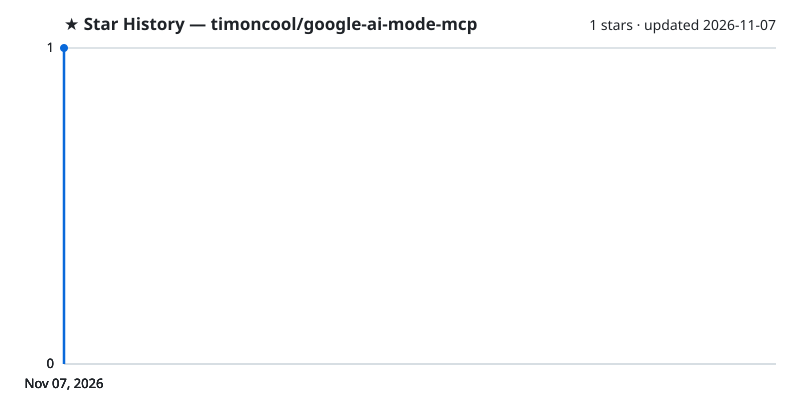

<div align="center">


# Google AI Mode MCP

**Google AI Mode for Claude and any MCP client — cited AI answers from your own browser, in about three seconds, with no tabs, no API keys and no quotas of its own.**

[](https://github.com/timoncool/google-ai-mode-mcp/stargazers)
[](LICENSE)
[](https://github.com/timoncool/google-ai-mode-mcp/commits/main)
[](https://github.com/timoncool/google-ai-mode-mcp/issues)

**[English](README.md)** · **[Русский](README_RU.md)**

</div>

Google AI Mode reads dozens of pages and writes one answer with sources. This MCP server hands that answer to your agent: Claude asks a question, a small browser extension asks Google in your own Chrome, signed in as you, and the answer comes back as clean Markdown with citations. One call replaces reading five to ten pages, at a fraction of the tokens.

## Features

- **Fast** — about 3 s per answer on average in our tests (6.2 s → 3.2 s against the extension this grew from): the answer is taken the moment Google marks it finished, and the extension gets each query instantly over a long-poll.
- **Invisible** — in Chrome every search runs in a hidden offscreen frame: no tab, no window, nothing flashes on screen.
- **Follow-ups** — keep asking in the same Google conversation; it is reopened from its link even after the frame is gone, for 30 minutes.
- **Parallel** — `search_many` sends up to 10 questions at once, about as fast as one.
- **Local results** — `gl="us"` (or any country) for prices, availability and local news.
- **Any UI language** — works with Google in English, Russian or any other language.
- **Clean answers** — no interface leftovers in the text, non-Latin text stays as text (no `\uXXXX` token bloat).
- **Clear errors** — a CAPTCHA, a sleeping extension or a used-up quota come back with a hint for the agent.
- **Your account, your machine** — no API keys, no paid proxy, nothing leaves your computer except the search itself.

## Install

You need [uv](https://docs.astral.sh/uv/) and Chrome (Firefox works too, with background tabs instead of hidden frames).

**1. MCP server — one command:**

```bash
claude mcp add google-ai-mode -- uvx --from git+https://github.com/timoncool/google-ai-mode-mcp#subdirectory=server google-ai-mode-mcp
```

Claude Desktop, Cursor and other clients — the same command in their config:

```json
{
  "mcpServers": {
    "google-ai-mode": {
      "command": "uvx",
      "args": ["--from", "git+https://github.com/timoncool/google-ai-mode-mcp#subdirectory=server", "google-ai-mode-mcp"]
    }
  }
}
```

**2. Browser extension** — it ships inside the package:

```bash
uvx --from git+https://github.com/timoncool/google-ai-mode-mcp#subdirectory=server google-ai-mode-mcp --extension
```

The command copies the extension to a fixed folder and prints its path. Open `chrome://extensions`, turn on **Developer mode**, click **Load unpacked** and pick that folder. To update later, run the command again and press the reload arrow on the extension's card.

**3. Skill (optional)** — copy [`skills/google-ai-mode`](skills/google-ai-mode/SKILL.md) to `~/.claude/skills/` so Claude knows when to search and how to ask.

## Tools

| Tool | What it does |
|---|---|
| `search(query, mode, gl, hl)` | One question → answer, `citations`, `thread_id`. `mode="fast"` for quick facts, `gl` for a country |
| `search_many(queries)` | Up to 10 independent questions in parallel, results in the same order |
| `follow_up(query, thread_id)` | Next question in the same conversation |
| `generate_image(prompt, save_path)` | Image from Google's generator in AI Mode |
| `health()` | Server and extension status, with a hint if something is off |

Ask in the language you want the answer in: the answer follows the language of the question (`hl` only switches Google's interface).

## How it works

```
Claude ──MCP──▶ google-ai-mode-mcp ──HTTP──▶ local relay :15551 ◀──long-poll── browser extension
                                                                                  │
                                         hidden offscreen frame: google.com/search?udm=50
```

- The MCP server starts a small local relay. The extension holds an open request to it and receives each query the moment it arrives.
- In Chrome the query opens in an iframe of an offscreen document. Google forbids framing its pages, so a session rule lifts the framing headers only for requests that belong to no tab; your normal browsing is untouched.
- The answer is read when Google renders its rating buttons under it, hidden interface text is dropped, and the conversation link is kept for follow-ups.

Settings (extension options): where searches run — hidden frames (default) or background tabs. Environment: `GOOGLE_AI_SCRAPER_URL` (relay address), `GOOGLE_AI_SCRAPER_CLOSE_AFTER_SEARCH=0` to keep tabs open between follow-ups in tab mode.

**Limits.** This uses Google Search like a person does, through your browser; Google may show a CAPTCHA — open Google once, solve it, and retry. Hidden frames need Chrome (or any Chromium); Firefox uses background tabs.

Inspired by [balakumardev/google-ai-scraper](https://github.com/balakumardev/google-ai-scraper).

## Other Projects by [@timoncool](https://github.com/timoncool)

| Project | Description |
|---------|-------------|
| [telegram-api-mcp](https://github.com/timoncool/telegram-api-mcp) | Full Telegram Bot API as an MCP server |
| [civitai-mcp-ultimate](https://github.com/timoncool/civitai-mcp-ultimate) | Civitai API as an MCP server — models, images, prompts |
| [trail-spec](https://github.com/timoncool/trail-spec) | TRAIL — cross-MCP content tracking protocol |
| [ACE-Step Studio](https://github.com/timoncool/ACE-Step-Studio) | AI music studio — songs, vocals, covers, videos |
| [VideoSOS](https://github.com/timoncool/videosos) | AI video production in the browser |
| [Bulka](https://github.com/timoncool/Bulka) | Live-coding music platform |

## Authors

- **Nerual Dreming** — [Telegram](https://t.me/nerual_dreming) | [neuro-cartel.com](https://neuro-cartel.com) | [ArtGeneration.me](https://artgeneration.me)

## Support the Author

I build open-source software and do AI research. Most of what I create is free and available to everyone. Your donations help me keep creating without worrying about where the next meal comes from =)

**[All donation methods](https://github.com/timoncool/ACE-Step-Studio/blob/master/DONATE.md)** | **[dalink.to/nerual_dreming](https://dalink.to/nerual_dreming)** | **[boosty.to/neuro_art](https://boosty.to/neuro_art)**

- **BTC:** `1E7dHL22RpyhJGVpcvKdbyZgksSYkYeEBC`
- **ETH (ERC20):** `0xb5db65adf478983186d4897ba92fe2c25c594a0c`
- **USDT (TRC20):** `TQST9Lp2TjK6FiVkn4fwfGUee7NmkxEE7C`

## Star History

<a href="https://github.com/timoncool/google-ai-mode-mcp/stargazers">
 <picture>
   <source media="(prefers-color-scheme: dark)" srcset="docs/stars-dark.svg" />
   <source media="(prefers-color-scheme: light)" srcset="docs/stars-light.svg" />
   
 </picture>
</a>

## License

MIT
