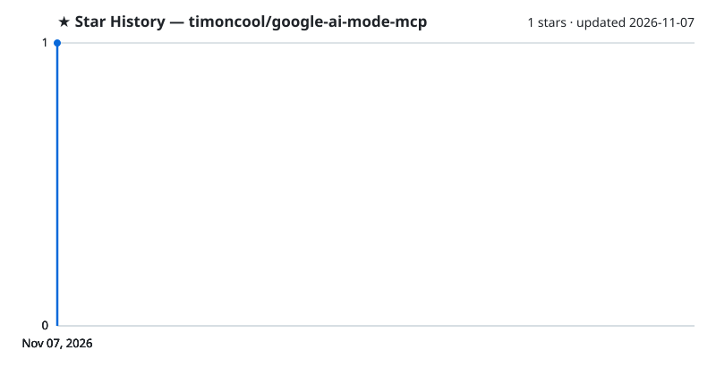

<div align="center">


# Google AI Mode MCP

**Режим ИИ Google для Claude и любого MCP-клиента — ответы с источниками из вашего собственного браузера примерно за три секунды, без вкладок, без ключей API и без своих лимитов.**

[](https://github.com/timoncool/google-ai-mode-mcp/stargazers)
[](LICENSE)
[](https://github.com/timoncool/google-ai-mode-mcp/commits/main)
[](https://github.com/timoncool/google-ai-mode-mcp/issues)

**[English](README.md)** · **[Русский](README_RU.md)**

</div>

Режим ИИ Google сам читает десятки страниц и пишет один ответ со ссылками. Этот MCP-сервер отдаёт такой ответ вашему агенту: Claude задаёт вопрос, маленькое расширение спрашивает Google в вашем Chrome под вашим аккаунтом, и ответ возвращается чистым Markdown с источниками. Один вызов заменяет чтение пяти-десяти страниц и стоит в разы меньше токенов.

## Возможности

- **Быстро** — в наших замерах в среднем около 3 с на ответ (6,2 с → 3,2 с против расширения, из которого вырос проект): ответ забирается в тот же миг, когда Google помечает его готовым, а запрос попадает в расширение сразу, без опроса по таймеру.
- **Невидимо** — в Chrome каждый поиск идёт в скрытом offscreen-фрейме: ни вкладки, ни окна, на экране ничего не мелькает.
- **Уточнения** — можно спрашивать дальше в том же диалоге Google; он открывается заново по ссылке даже после закрытия фрейма, 30 минут.
- **Параллельно** — `search_many` отправляет до 10 вопросов сразу, примерно за время одного.
- **По стране** — `gl="us"` (или любая страна) для цен, наличия и местных новостей.
- **Любой язык интерфейса** — работает с Google на русском, английском и любом другом.
- **Чистые ответы** — никакого мусора интерфейса в тексте, кириллица идёт текстом, а не `\uXXXX`.
- **Понятные ошибки** — капча, уснувшее расширение или исчерпанная квота приходят агенту с подсказкой, что делать.
- **Ваш аккаунт, ваш компьютер** — без ключей API и платных прокси, наружу уходит только сам поисковый запрос.

## Установка

Нужны [uv](https://docs.astral.sh/uv/) и Chrome (Firefox тоже подходит, но вместо скрытых фреймов — фоновые вкладки).

**1. MCP-сервер — одной командой:**

```bash
claude mcp add google-ai-mode -- uvx --from git+https://github.com/timoncool/google-ai-mode-mcp#subdirectory=server google-ai-mode-mcp
```

Claude Desktop, Cursor и другие клиенты — та же команда в их конфиге:

```json
{
  "mcpServers": {
    "google-ai-mode": {
      "command": "uvx",
      "args": ["--from", "git+https://github.com/timoncool/google-ai-mode-mcp#subdirectory=server", "google-ai-mode-mcp"]
    }
  }
}
```

**2. Расширение браузера.** Его нет ни в одном магазине: вы один раз загружаете его в браузер сами.

*Chrome, Brave, Vivaldi, Opera и другие браузеры на Chromium:*

1. Достаньте расширение из пакета:

   ```bash
   uvx --from git+https://github.com/timoncool/google-ai-mode-mcp#subdirectory=server google-ai-mode-mcp --extension
   ```

   Команда печатает папку, куда его скопировала:

   | ОС | Папка |
   |---|---|
   | Windows | `%LOCALAPPDATA%\google-ai-mode-mcp\extension` |
   | macOS | `~/Library/Application Support/google-ai-mode-mcp/extension` |
   | Linux | `~/.local/share/google-ai-mode-mcp/extension` |

2. Откройте страницу расширений (`chrome://extensions`, `brave://extensions`, …), включите **Режим разработчика** в правом верхнем углу, нажмите **Загрузить распакованное расширение** и выберите эту папку.
3. Не трогайте папку: браузер грузит расширение прямо из неё, и если её удалить или перенести, расширение пропадёт.
4. В этом браузере нужно войти в Google — поиск идёт от вашего аккаунта. Режим ИИ должен быть для него доступен: `https://www.google.com/search?udm=50&q=test` должен открыть ответ режима ИИ.
5. Проверьте связь: при запущенном MCP-сервере окно расширения пишет **Сервер и расширение подключены**, а инструмент `health` возвращает `extension_connected: true`.

Обновление — снова команда из шага 1 и круглая стрелка на карточке расширения. Без uv: склонируйте репозиторий (или **Code → Download ZIP**) и загрузите его папку `extension/`.

*Firefox 128+* (поиск идёт в фоновых вкладках, а не в скрытых фреймах). Версия для Firefox лежит в репозитории, в пакет она не входит:

1. `git clone https://github.com/timoncool/google-ai-mode-mcp` или **Code → Download ZIP** и распакуйте.
2. Откройте `about:debugging`, нажмите **Этот Firefox** → **Загрузить временное дополнение** и выберите `firefox-extension/manifest.json`.
3. При перезапуске Firefox удаляет временные дополнения, так что шаг 2 придётся повторять после каждого перезапуска. Чтобы дополнение оставалось, используйте Firefox Developer Edition или Nightly:
   - в `about:config` выставьте `xpinstall.signatures.required` в `false`;
   - запакуйте содержимое `firefox-extension/` в zip;
   - установите его через `about:addons` → шестерёнка → **Установить дополнение из файла**.

**3. Скилл (по желанию)** — скопируйте [`skills/google-ai-mode`](skills/google-ai-mode/SKILL.md) в `~/.claude/skills/`, и Claude будет знать, когда искать и как спрашивать.

## Инструменты

| Инструмент | Что делает |
|---|---|
| `search(query, mode, gl, hl)` | Один вопрос → ответ, `citations`, `thread_id`. `mode="fast"` для быстрых фактов, `gl` — страна |
| `search_many(queries)` | До 10 независимых вопросов параллельно, ответы в том же порядке |
| `follow_up(query, thread_id)` | Следующий вопрос в том же диалоге |
| `generate_image(prompt, save_path)` | Картинка из генератора Google в режиме ИИ |
| `health()` | Состояние сервера и расширения, с подсказкой, если что-то не так |

Спрашивайте на том языке, на котором нужен ответ: ответ идёт на языке вопроса (`hl` меняет только интерфейс Google).

## Бенчмарк

25 вопросов с заранее известными ответами, три инструмента поиска, слепой ИИ-судья (Claude Opus 5.5), который видел только случайные ID:

| | Google AI Mode MCP | Claude Code WebSearch | Exa |
|---|---|---|---|
| Лучший ответ (из 25) | **10** | 5 | **10** |
| Средний ранг (1 — лучший) | **1,76** | 2,36 | 1,88 |
| Полностью верно | **23/25** | 19/25 | **23/25** |
| Медиана времени | 3,1 с | 5,1 с | **0,95 с** |
| Текста ассистенту на 25 ответов | 31 тыс. символов | 21 тыс. | 433 тыс. |

AI Mode даёт лучшие ответы в целом при доле текста Exa; Exa быстрее всех и с лучшими источниками, WebSearch ошибается чаще остальных. Если спрашивать так, как учит [скилл](skills/google-ai-mode/SKILL.md), AI Mode ссылается на официальный или первичный источник в 22 ответах из 24 вместо 13, а текста вдвое меньше ([до и после](benchmarks/2026-11-07-skill/README.md)). Полный отчёт, все сырые ответы и вердикты, процедура для проверки любого инструмента поиска: [benchmarks/](benchmarks/README.md).

## Как это работает

```
Claude ──MCP──▶ google-ai-mode-mcp ──HTTP──▶ локальный ретранслятор :15551 ◀──long-poll── расширение браузера
                                                                                              │
                                                   скрытый offscreen-фрейм: google.com/search?udm=50
```

- MCP-сервер поднимает маленький локальный ретранслятор. Расширение держит к нему открытый запрос и получает каждый вопрос в момент его появления.
- В Chrome вопрос открывается в iframe offscreen-документа. Google запрещает встраивать свои страницы, поэтому правило сессии снимает этот запрет только для запросов, не принадлежащих ни одной вкладке; обычный браузинг не затрагивается.
- Ответ забирается, когда Google рисует под ним кнопки оценки, скрытый текст интерфейса отбрасывается, а ссылка на диалог сохраняется для уточнений.

Настройки (параметры расширения): где идёт поиск — в скрытых фреймах (по умолчанию) или в фоновых вкладках. Переменные окружения: `GOOGLE_AI_SCRAPER_URL` — адрес ретранслятора, `GOOGLE_AI_SCRAPER_CLOSE_AFTER_SEARCH=0` — не закрывать вкладки между уточнениями в режиме вкладок.

**Ограничения.** Поиск идёт так же, как у человека, — через ваш браузер; Google может показать капчу: откройте Google, пройдите её и повторите. Скрытые фреймы работают в Chrome и других Chromium-браузерах, Firefox использует фоновые вкладки.

Вдохновлено проектом [balakumardev/google-ai-scraper](https://github.com/balakumardev/google-ai-scraper).

## Другие проекты [@timoncool](https://github.com/timoncool)

| Проект | Описание |
|--------|----------|
| [telegram-api-mcp](https://github.com/timoncool/telegram-api-mcp) | Telegram Bot API целиком как MCP-сервер |
| [civitai-mcp-ultimate](https://github.com/timoncool/civitai-mcp-ultimate) | Civitai API как MCP-сервер — модели, картинки, промпты |
| [trail-spec](https://github.com/timoncool/trail-spec) | TRAIL — протокол отслеживания контента между MCP |
| [ACE-Step Studio](https://github.com/timoncool/ACE-Step-Studio) | AI-студия музыки — песни, вокал, каверы, клипы |
| [VideoSOS](https://github.com/timoncool/videosos) | AI-видеопродакшн в браузере |
| [Bulka](https://github.com/timoncool/Bulka) | Платформа лайв-кодинга музыки |

## Авторы

- **Nerual Dreming** — [Telegram](https://t.me/nerual_dreming) | [neuro-cartel.com](https://neuro-cartel.com) | [ArtGeneration.me](https://artgeneration.me)

## Поддержать автора

Я создаю опенсорс софт и занимаюсь исследованиями в области ИИ. Большая часть всего, что я делаю, находится в открытом доступе. Ваши пожертвования позволяют мне создавать и исследовать больше, не отвлекаясь на поиск еды для продолжения существования =)

**[Все способы поддержки](https://github.com/timoncool/ACE-Step-Studio/blob/master/DONATE.md)** | **[dalink.to/nerual_dreming](https://dalink.to/nerual_dreming)** | **[boosty.to/neuro_art](https://boosty.to/neuro_art)**

- **BTC:** `1E7dHL22RpyhJGVpcvKdbyZgksSYkYeEBC`
- **ETH (ERC20):** `0xb5db65adf478983186d4897ba92fe2c25c594a0c`
- **USDT (TRC20):** `TQST9Lp2TjK6FiVkn4fwfGUee7NmkxEE7C`

## Star History

<a href="https://github.com/timoncool/google-ai-mode-mcp/stargazers">
 <picture>
   <source media="(prefers-color-scheme: dark)" srcset="docs/stars-dark.svg" />
   <source media="(prefers-color-scheme: light)" srcset="docs/stars-light.svg" />
   
 </picture>
</a>

## Лицензия

MIT
